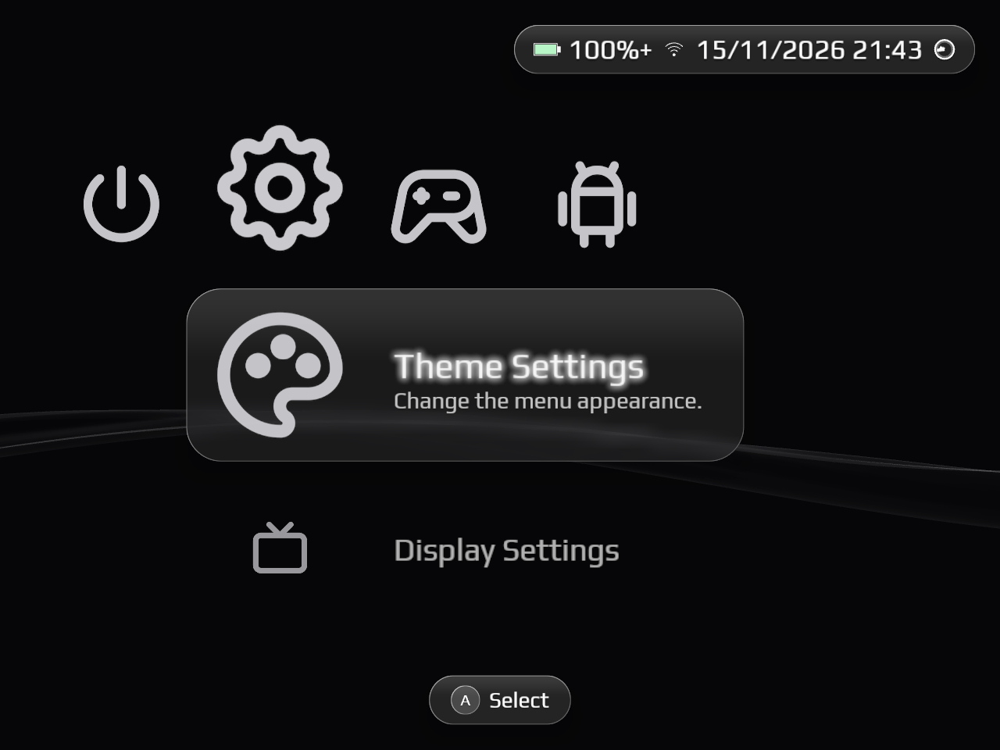
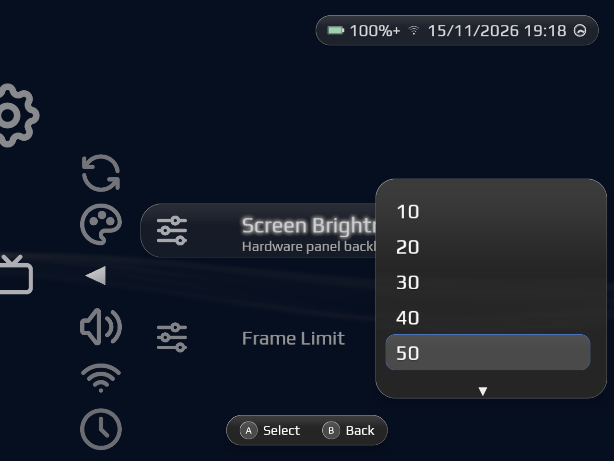

# nova-xmb

The console menu of [nova-nix](https://github.com/hjcoggan/nova-nix), a
console-style Linux system for the Retroid Pocket Nova (1280x960, 4:3). It is
a fork of [OpenXMB](https://github.com/phenom64/OpenXMB) 0.3.0-beta.3: a PS3
XrossMediaBar in C++23 modules, Vulkan and SDL2, given a console mode and a
Liquid Glass look.

<p align="center">
  
  
</p>

nova-nix builds it, starts it as the only program of the session and pins the
exact commit in its `flake.lock`. Everything here is meant to run there; the
desktop parts of OpenXMB are still in the tree but are not what this fork is
about.

## What it does

- **Console mode.** Four crossbar columns: Power, Settings, Games and Android
  (plus Applications when there are any). Buttons follow the Nintendo layout
  printed on the device: A confirms, B goes back.
- **Game library.** Games come from `~/Games/<id>/game.json` and Android apps
  from Waydroid. Y > Move reorders a game or carries it to another column; the
  order is kept in the profile config. Every row, logo or icon, has one shape.
- **Launching.** A game starts through `nova-launch <id>` behind a full-screen
  loading card with its art. While it runs, the menu draws nothing and idles.
- **Pause.** nova-nix's Home daemon freezes the game and sends `PAUSE <id>` on
  `$XDG_RUNTIME_DIR/nova-pause.sock`. The menu captures the frozen frame with
  `grim`, opens the pause panel over it (Resume, Volume, Brightness, Quit Game)
  and answers through `nova-home-ctl`. `RESUME`, `QUIT` and `POWER_MENU` are
  the other messages.
- **Settings wired to the hardware**: screen brightness, volume and output,
  Wi-Fi, Bluetooth, aeroplane mode, system update. Defaults come from
  `/etc/nova/menu-defaults.json`, written by nova-nix.
- **Status bar** with battery, charging, Wi-Fi strength and the clock.

## The look

One material, Liquid Glass, for every surface: the crossbar and Settings
lenses, the Options menu and value pickers, the pause card, dialogs, the launch
card, the status bar and the hint bar. A pane of glass shows the scene behind it
blurred, bent near its edges, with a rim lit from the upper left, and darkens
over bright scenes so white text keeps at least 7:1 contrast.

- `include/openxmb/xmb/glass.hpp`: the variants (`regular`, `clear`, `focus`),
  shape and colour tokens, contrast maths, focus slide and panel motion.
- `include/openxmb/xmb/glass_draw.hpp` and `xmb_canvas::glass`: the one way to
  draw a pane. `shell::render_hint_bar`: the one hint bar.
- `nova/aurore-engine.patch`: the engine side. AuroreEngine's glass shader
  gains a panel mode that samples a mipmapped copy of the scene behind the
  interface; the shell builds that copy every frame, or uses the captured game
  frame while paused.

No screen draws its own panel out of rectangles; new screens should use the
same primitives.

## Building

With nova-nix (what the device runs), from a nova-nix checkout:

```sh
nix build .#openxmb --override-input nova-xmb path:/path/to/nova-xmb
nix build .#openxmb-tests --override-input nova-xmb path:/path/to/nova-xmb
```

By hand: configure with `-DAUROREENGINE_LOCAL=<engine checkout>`, where the
checkout is AuroreEngine `52c724e3` with `nova/aurore-engine.patch` applied
(`patch -p1 < nova/aurore-engine.patch`). nova-nix also passes
`-DENABLE_BROWSER=OFF -DENABLE_DISC_MEDIA=OFF -DENABLE_LIBRETRO=OFF` and
`-DOPENXMB_DEFAULT_UI_SCALE=1.5` in `CMAKE_CXX_FLAGS`; `pkgs/openxmb` in
nova-nix has the full recipe.

## Tests

The native suite (`-DOPENXMB_BUILD_NATIVE_TESTS=ON`, run by `ctest`) is what
`nix build .#openxmb-tests` runs; nova-nix's `nix flake check` includes it. The
glass, pause-capture and IPC tests need only a compiler:

```sh
g++ -std=c++23 -Wall -Wextra -Werror -Iinclude tests/xmb/glass_tests.cpp -o glass_tests
OPENXMB_ENGINE_SHADER=<engine checkout>/shaders/image_renderer.glass.frag ./glass_tests
```

A change to what is on screen is not done until it has been looked at on the
device; nova-nix's `docs/DEVELOPMENT.md` has the commands.

## Licence

GPL-3.0 ([LICENSE](LICENSE)), as OpenXMB. The wave shaders adapted from
RetroArch are covered by [LICENSE.RetroArch](LICENSE.RetroArch). AuroreEngine,
and the parts of it adapted from dreamrender, are MPL-2.0
([LICENSES/MPL-2.0.txt](LICENSES/MPL-2.0.txt)); `nova/aurore-engine.patch`
modifies it under that licence. Bundled third-party notices are in
[LICENSES](LICENSES).

## Credits

- **[OpenXMB](https://github.com/phenom64/OpenXMB)** by Syndromatic Ltd
  (phenom64), Kavish Krishnakumar and contributors: the menu this fork is
  built on.
- **[XMBShell](https://github.com/JnCrMx/xmbshell)** by JCM (JnCrMx): the base
  that much of OpenXMB is derived from.
- **[AuroreEngine](https://github.com/phenom64/AuroreEngine)** by phenom64, and
  **[dreamrender](https://github.com/JnCrMx/dreamrender)** by JnCrMx that it is
  based on: the rendering engine.
- **[RetroArch](https://github.com/libretro/RetroArch)**: the XMB ribbon
  shaders and parts of the media code.
- **[xmb-web](https://github.com/TheGammaSqueeze/xmb-web)** by TheGammaSqueeze:
  OpenXMB's reference for the original XMB's colours, waves and glass icons.
- **[MaXMB](https://github.com/MaxiBono/MaXMB)** by MaxiBono (MIT): the menu
  idling while a launched game runs is adapted from its `app_launch.cpp`.
- **[Tabler Icons](https://tabler.io/icons)** (MIT): the crossbar, settings and
  power icons under `assets/shell/icons`, aspect-corrected for the menu.
- **Liquid Glass**: Apple's design language is the reference for the look. No
  Apple code or assets are used; the material is written here for Vulkan.
  These guides shaped the rules it follows:
  [liquid-glass-design](https://github.com/affaan-m/ecc) (affaan-m),
  [swiftui-liquid-glass](https://github.com/dpearson2699/swift-ios-skills)
  (dpearson2699), [swiftui-liquid-glass](https://github.com/dimillian/skills)
  (Dimillian) and [glassmorphism](https://github.com/bergside/awesome-design-skills)
  (bergside).
- Libraries: SDL2, Vulkan, Vulkan-Hpp, VulkanMemoryAllocator-Hpp, glm,
  FreeType, FFmpeg, fmt, spdlog, nlohmann/json, i18n-cpp, argparse and
  fast_float.
